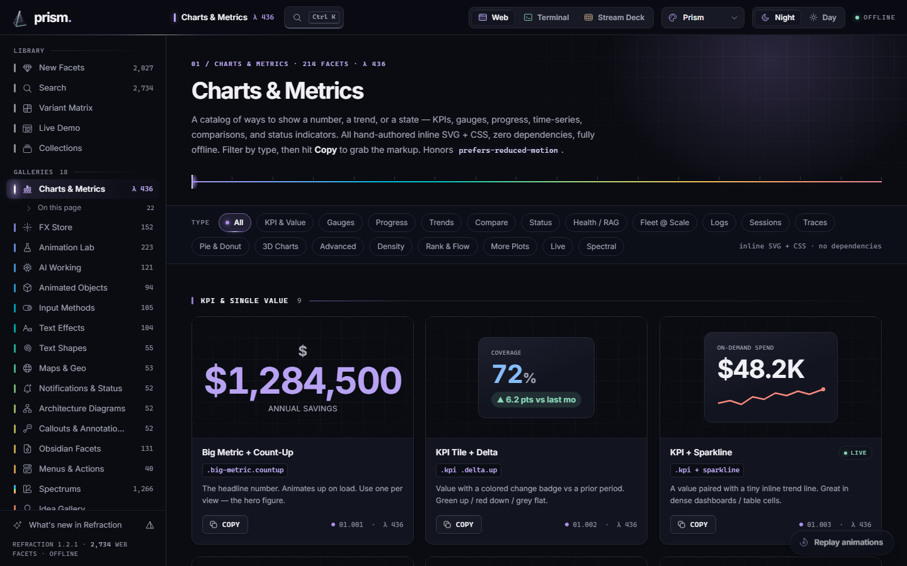
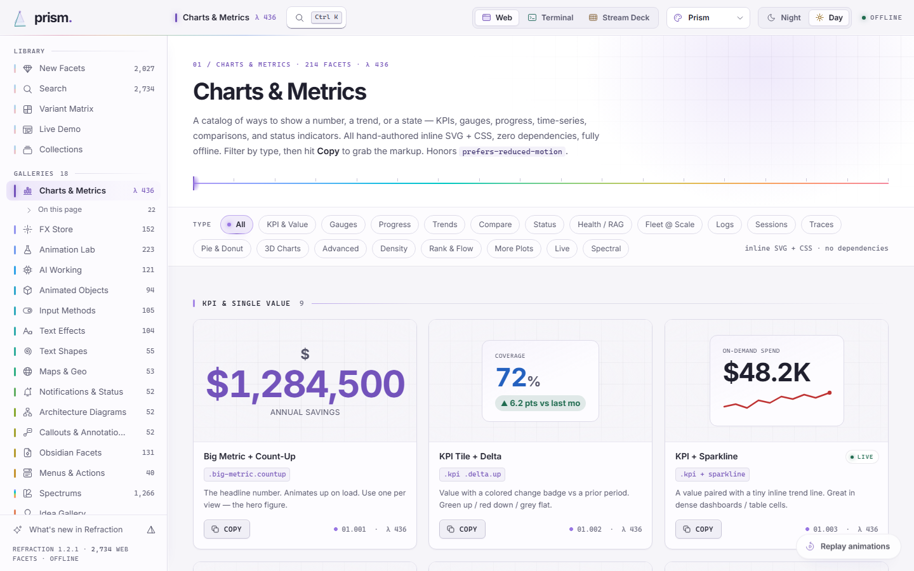
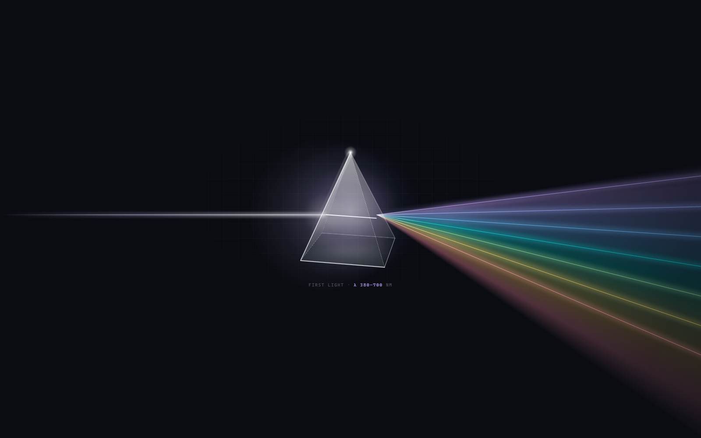
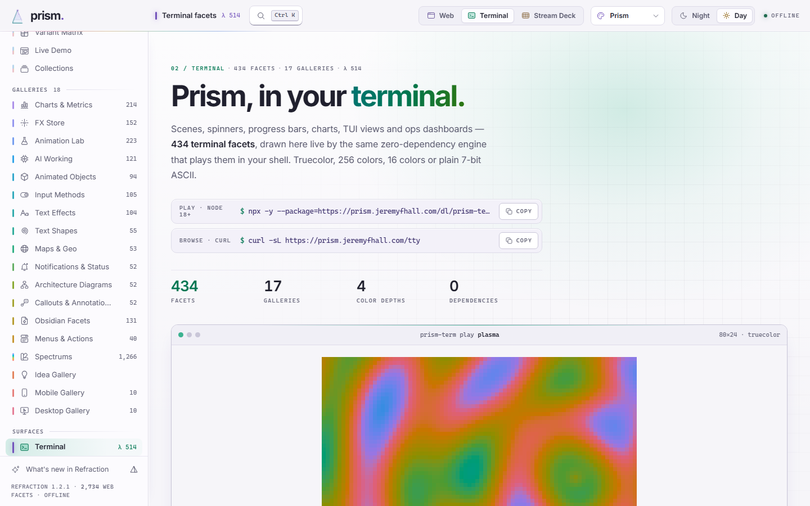
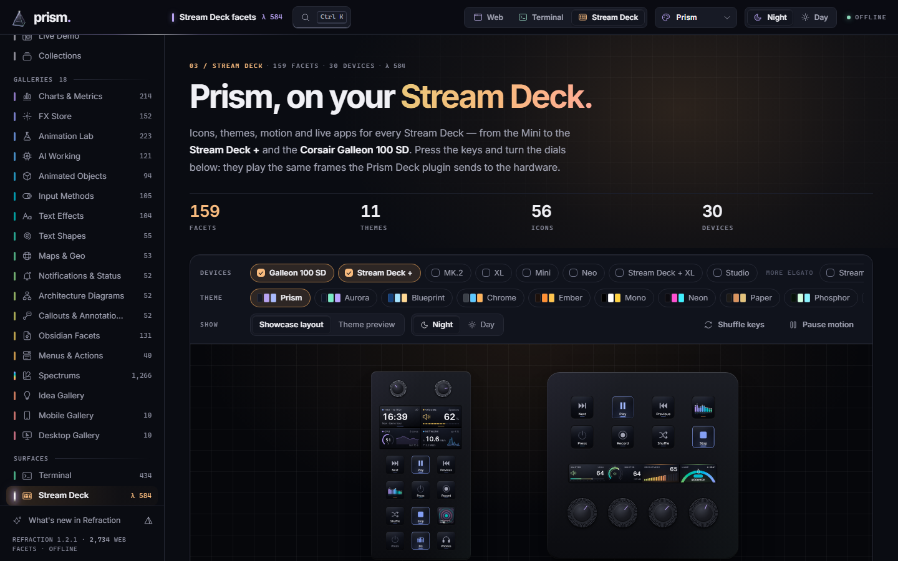

<div align="center">

<picture>
  <source media="(prefers-color-scheme: light)" srcset="design/brand/prism-lockup-day.svg">
  
</picture>

**White light in. Every color out.**

Prism is a library of animated facets for three surfaces: the **web** (one offline HTML file), the **terminal** and the **Stream Deck**. Humans browse it. AI agents drive it through a zero-dependency MCP server. Everything speaks **Refraction**, Prism's own design language, in **Prism Night** and **Prism Day**.

**[prism.jeremyfhall.com](https://prism.jeremyfhall.com)** · `curl -sL https://prism.jeremyfhall.com/tty`

     

</div>

<table>
  <tr>
    <td></td>
    <td></td>
  </tr>
  <tr>
    <td align="center"><sub><b>Prism Night</b> · ink-navy glass, lit from inside</sub></td>
    <td align="center"><sub><b>Prism Day</b> · pearl paper with an iridescent sheen</sub></td>
  </tr>
</table>

---

## What Prism is

Prism is a design library of animated elements, called **facets**: charts, visual effects, "AI is thinking" states, 3D objects, form inputs, text treatments, offline maps, notifications, architecture diagrams, report callouts, terminal scenes and Stream Deck keys. Every facet is hand-authored. Nothing is fetched from a network, so anything you take out of Prism runs anywhere, fully offline.

It ships three surfaces, and they share one family of tokens, hues, icons and labels:

| Surface | What's in it | Where to see it | Docs |
|---|---|---|---|
| **Web** | **2,714** CSS/SVG facets in 15 galleries, in one HTML file (`Prism.html`) | open `Prism.html`, or [prism.jeremyfhall.com/Prism.html](https://prism.jeremyfhall.com/Prism.html) | [The web catalog](#the-web-catalog) |
| **Terminal** | **434** terminal facets in 17 galleries, drawn by [`prism-term`](./prism-term) | `curl`, live with `npx`, or [prism.jeremyfhall.com/terminal/](https://prism.jeremyfhall.com/terminal/) | [`prism-term/README.md`](./prism-term/README.md) |
| **Stream Deck** | **159** Stream Deck facets (11 themes, 56 glyphs, live apps) for 30 devices, drawn by [`prism-deck`](./prism-deck) | the Stream Deck app (plugin, icon packs, profiles), Linux, or [prism.jeremyfhall.com/deck/](https://prism.jeremyfhall.com/deck/) | [`prism-deck/README.md`](./prism-deck/README.md) |

It serves two audiences from the same source of truth:

- **Humans** browse the galleries and hit **Copy** on any facet to get ready-to-paste, self-contained markup. In the terminal, they play facets live. On a Stream Deck, they put them on keys.
- **AI agents** talk to the **Prism MCP server** ([`prism-mcp-server/`](./prism-mcp-server)), or read the JSON islands embedded in `Prism.html`, to discover facets and compose them: *"make the KPI cards pulse and put a wind backdrop behind the streaming agent text."*

`Prism.html` carries all three catalogs as JSON islands (web, terminal and Stream Deck), and the MCP server reads them.

---

## Quick start

**Web.** Open the hosted copy at [prism.jeremyfhall.com/Prism.html](https://prism.jeremyfhall.com/Prism.html), or open your own copy of `Prism.html` in any modern browser:

```bash
open Prism.html            # macOS
xdg-open Prism.html        # Linux
start Prism.html           # Windows (or double-click the file)
```

**Terminal.** Nothing to install for the curl site. The live player needs Node.js 18+:

```bash
curl -sL https://prism.jeremyfhall.com/tty                                           # every gallery, in your terminal
npx -y --package=https://prism.jeremyfhall.com/dl/prism-term.tgz prism-term          # the live catalog browser
```

From a clone: `cd prism-term && node cli.js`. In the browser, press **d** to flip Day and Night. To give your terminal emulator the same colors, run `node cli.js theme` (see [Prism for the terminal](#prism-for-the-terminal)).

**Stream Deck.** Get the plugin, an icon pack or a profile and double-click it. See [Getting started](./prism-deck/README.md#getting-started) for Windows, macOS and Linux. From a clone, build the files yourself:

```bash
cd prism-deck
node scripts/build-plugin.mjs        # → plugin/dist/com.jeremyfhall.prism.streamDeckPlugin
node scripts/build-iconpacks.mjs     # → plugin/dist/iconpacks/*.streamDeckIconPack + plugin/dist/profiles/*.streamDeckProfile
node cli.js render span-waveform --device plus --out out/    # or just render a facet to SVG
```

**Agents.** Point any MCP client at the server. There's nothing to `npm install`:

```bash
claude mcp add prism -- node /ABS/PATH/prism/prism-mcp-server/cli.js start --catalog /ABS/PATH/prism/Prism.html
```

See [Install the MCP server](#install-the-mcp-server) for Claude Desktop and the Anthropic API.

---

## Refraction, the design language

Prism used to wear AWS Cloudscape. **Refraction** replaces it with a language of its own. A prism turns one plain beam into a whole spectrum, and the interface makes that literal, with restraint:

- **Night and Day.** **Prism Night** (`prism-dark`) is deep ink-navy glass lit from inside. **Prism Day** (`prism-light`) is pearl paper with an iridescent sheen. Each mode has its own art direction; Day is not an inverted Night. On your first visit Prism follows your system's light or dark setting. After that, your choice sticks.
- **The spectrum is the accent system.** One perceptually even OKLCH ramp, violet to rose. Every gallery owns a position on it, shown as a hue tick and a wavelength label (`λ 436`) in the sidebar's spectral index. Each surface owns one too: Web violet, Terminal mint, Stream Deck amber.
- **The beam.** A hairline of white light marks where you are: the active nav item, focus rings, progress, the theme switch.
- **First Light.** On load, a beam crosses the dark screen, strikes the glass prism and fans into the spectrum, and the spectrum paints the app in. It takes at most 1.6 s, never blocks input, ends on any key or click, and plays in full once per session. With reduced motion it is replaced by a short fade.
- **Its own icons and type.** A hairline icon family drawn on a 24 px grid replaces every emoji in the chrome. Inter 400, 600 and 700 are bundled, so nothing loads from a font CDN.

The spec, tokens and generators live in [`design/`](./design). Start with [`design/README.md`](./design/README.md) and the living specimen, [`design/specimen.html`](./design/specimen.html).



---

## The web catalog

### Opening it

`Prism.html` opens with First Light, then routes by device: touch devices land on **Mobile**, everything else on **New Facets**. A `#hash` in the URL (for example `Prism.html#objects`) always wins, so you can deep-link a gallery. To use a facet, browse to it, click **Copy** (or **Copy snippet**) and paste. If the facet reads theme tokens, include the design tokens once globally (see [Composing an effect](#composing-an-effect)).

The top bar holds what you need to get around:

- **Surface switcher** (`Web | Terminal | Stream Deck`): the Terminal and Stream Deck pages run the real terminal and deck engines inside `Prism.html`.
- **Search** (`Ctrl K` / `⌘K`): a command palette over every facet, gallery and command. Commands include *Switch to Day/Night*, *Use the … skin*, *Replay First Light*, *Replay animations on this page*, *Reduce motion* and *What's new in Refraction*.
- **Design-system picker**: Prism, or one of 11 other skins (see [Themes and skins](#themes-and-skins)).
- **Night | Day**: relights the page with a beam sweep (any input ends it at once).

**Facets and markers.** New facets carry a **NEW** badge and refreshed ones an **UPDATED** badge. Both are collected on the **New Facets** page. Every tile that runs a CSS animation gets a small replay button, and each gallery has a floating **Replay animations** button. They sit outside the tile's `.stage`, so they never end up in a copied snippet.

### The galleries

Fifteen authored galleries, listed in navigation order. That's also spectral order: each gallery's hue and λ come from its position on the spectrum. Every facet carries a name, its canonical CSS selector (`.ref`), a one-line description and a copy button. (The terminal galleries are listed under [Prism for the terminal](#the-terminal-galleries).)

| λ | Gallery | What's inside | Count |
|---|---|---|--:|
| 436 | **Charts & Metrics** | KPIs, gauges, progress, trends, comparisons, status, 3D charts | 214 |
| 467 | **FX Store** | Drop-in visual effects: glow, pulse, shimmer, glass, particles, glitch | 152 |
| 474 | **Animation Lab** | Motion studies: easing, transforms, loaders, physics, keyframes | 223 |
| 479 | **AI Working** | "Thinking" states, token streams, tool calls, model internals | 121 |
| 483 | **Animated Objects** | Self-contained animated SVG/CSS objects, icons, 3D objects | 94 |
| 487 | **Input Methods** | Controls, pickers, toggles, interactive input patterns | 105 |
| 492 | **Text Effects** | Gradient, neon, glitch, shimmer, kinetic, 3D/extruded text | 104 |
| 499 | **Text Shapes** | Text arranged into arcs, rings, spirals, 3D tunnels | 55 |
| 519 | **Maps & Geo** | Offline SVG maps, pulsing markers, great-circle arcs, choropleths, radar, telemetry | 53 |
| 550 | **Notifications & Status** | Toasts, snackbars, banners, live indicators, empty states, skeletons | 52 |
| 563 | **Architecture Diagrams** | Service nodes, animated connectors, VPC containers, sequence and flow diagrams | 52 |
| 570 | **Callouts & Annotations** | Admonitions, badges and pills, timelines, dividers, tooltips, key-value meta | 52 |
| 576 | **Obsidian Facets** | Callouts, graph links, note chrome, Dataview dashboards, Canvas, focus scenes | 131 |
| 581 | **Menus & Actions** | Dropdowns, context menus, command palettes, action bars, radial menus | 40 |
| 586 | **Spectrums** | Component families across full visual languages (Material, glass, brutalist, solarpunk …) | 1,266 |

**Also in the sidebar.** The *Library* pages carry no hue, because they're white light: **New Facets** (everything tagged new or updated), **Search**, **Variant Matrix** (one component under every theme), **Live Demo** (a sample site you can reskin) and **Collections**. Three more galleries follow the fifteen: **Idea Gallery** (paste code, tweak variables, preview live), **Mobile** and **Desktop** (the library sliced by input type). The *Surfaces* group holds the **Terminal** and **Stream Deck** pages.

### Themes and skins

Prism's default look is **Refraction**: **Prism Night** (`prism-dark`) and **Prism Day** (`prism-light`). Switch modes with **Night | Day** in the top bar or from the command palette. Your choice is saved in `localStorage.prismTheme`.

Every theme is a pure `:root` token swap (`--bg`, `--ink`, `--accent`, `--info`, `--pos` …) over identical HTML and CSS. The shell and every gallery re-theme at once, and facets you copy re-theme with whatever tokens you give them. The design-system picker keeps eleven other skins, each in a dark and a light mode: Cloudscape, Duolingo, Mailchimp, Stack Overflow, Monzo, Heroku, Shopify Polaris, GitHub Primer, Ant Design, Firefox Acorn and Material Design 3. That makes 24 themes in all.

If you last used Prism on its old Cloudscape default, your saved choice moves to Prism Night or Prism Day, in the same mode, the first time you open this version. Pick Cloudscape again from the design-system picker and it stays.

---

## Prism for the terminal

Prism's second catalog is drawn in text: **434 terminal facets** in **17 galleries**. You get spinners, progress bars and counters, charts, Linux and ops views, TUI controls, diagrams, text art and demoscene effects, sorted into galleries and categories exactly like the web catalog. Every facet is drawn by [`prism-term`](./prism-term), a zero-dependency Node engine. It adapts to the terminal it lands in: truecolor down to mono, braille and block glyphs down to 7-bit ASCII, 80×24 and up.

The chrome speaks Refraction too, in cells: the beam, the spectral index with λ labels, glass frames and a terminal First Light. **Prism Night** and **Prism Day** are the default themes. prism-term picks the one that matches your terminal's background, and **d** flips between them. See [`prism-term/docs/refraction-terminal.md`](./prism-term/docs/refraction-terminal.md).

<table>
  <tr>
    <td></td>
    <td></td>
  </tr>
  <tr>
    <td align="center"><sub><b>In your terminal</b> · the catalog browser, Prism Night</sub></td>
    <td align="center"><sub><b>In Prism.html</b> · the Terminal page, Prism Day</sub></td>
  </tr>
</table>

There are four ways in:

| Where | What you get | Start with |
|---|---|---|
| **Your terminal, with curl** | the **terminal site**: every gallery and every facet as an 80-column ANSI page | `curl -sL https://prism.jeremyfhall.com/tty` |
| **Your terminal, live** | the **live player**: every facet animating in real time (Node.js 18+) | `npx -y --package=https://prism.jeremyfhall.com/dl/prism-term.tgz prism-term` |
| **Your browser** | the **terminal catalog** on the web, where every tile runs the real facet code, cell for cell | [prism.jeremyfhall.com/terminal/](https://prism.jeremyfhall.com/terminal/) |
| **Your agent** | the `#prism-terminal-catalog` JSON island and five MCP tools | [The terminal JSON island](#the-terminal-json-island) |

Step-by-step directions, with a preview of every curl page exactly as your terminal will show it, are at [prism.jeremyfhall.com/terminal/tty.html](https://prism.jeremyfhall.com/terminal/tty.html).

### The terminal galleries

| Gallery | id | What's inside | Count |
|---|---|---|--:|
| ✺ **FX Store** | `fx` | Full-field effects: plasma, fire, fractals, water and light. | 24 |
| ◈ **Animated Objects** | `objects` | 3D solids, wireframes, globes and mechanical things that move. | 18 |
| ✦ **Particles & Simulations** | `sim` | Particles, cellular automata, physics, flocking and weather. | 18 |
| ▚ **Retro & Demoscene** | `retro` | Cracktro scrollers, copper bars, BBS-era ANSI art and chiptune visuals. | 24 |
| Aa **Text Effects** | `text` | Banners, bitmap fonts, reveals, glitches and color on type. | 29 |
| ⠿ **Spinners & Loaders** | `loaders` | Every way to say "working…" in one or two cells. | 64 |
| ▰ **Progress & Counters** | `progress` | Progress bars, multi-step pipelines, counters, timers and transfer meters. | 41 |
| ▁▃▆ **Charts & Metrics** | `charts` | Sparklines, line and bar charts, gauges, heatmaps and KPI tiles. | 30 |
| ✳ **AI Working** | `ai` | Thinking states, token streams, tool calls and agent pipelines. | 18 |
| ● **Notifications & Status** | `status` | Toasts, status lines, badges, health indicators and log lines. | 18 |
| $_ **Linux & Ops** | `ops` | What you see on a real box: monitors, disks, network, services, containers and logins. | 39 |
| ┌┐ **Architecture Diagrams** | `diagrams` | Box-drawing flows, trees, topologies, sequences and git graphs. | 16 |
| ▌ **Callouts & Layout** | `callouts` | Panels, borders, admonitions, tables, dividers and key-value blocks. | 15 |
| ❯ **Input & Menus** | `input` | TUI controls: selects, checkboxes, text fields, palettes, dialogs and tab bars. | 23 |
| ◍ **Maps & Geo** | `maps` | World maps, radar sweeps, routes, arcs and floorplans in braille and blocks. | 11 |
| ∿ **Animation Lab** | `lab` | Motion studies: easing curves, springs, timing and the building blocks of animation. | 17 |
| # **Pure ASCII** | `ascii` | 7-bit only: no Unicode, no color required. Runs on a VT100, a serial console, anything. | 29 |

The taxonomy lives in [`prism-term/src/facets/galleries.js`](./prism-term/src/facets/galleries.js); `prism-term galleries` prints the same list with every category.

### Browse it with curl

The terminal site is a set of plain pages you read with `curl`. No install, no account, no JavaScript:

```bash
curl -sL https://prism.jeremyfhall.com/tty            # home: every gallery with its facet count
curl -sL https://prism.jeremyfhall.com/t/ops          # one gallery, by category
curl -sL https://prism.jeremyfhall.com/f/ops-htop     # one facet: a still frame, what it needs, how to run it
curl -sL https://prism.jeremyfhall.com/t/all          # every facet, one line each
curl -sL https://prism.jeremyfhall.com/t/help         # the manual
```

Pages are stills that fit 80 columns and use only color and text, with no cursor movement, so they work over SSH, inside tmux and in a CI log. Chrome text uses balanced tones that read on both dark and light terminals. Every page also comes in two variants:

- **`<page>.txt`**: plain 7-bit ASCII with no escape codes, for `grep`, `NO_COLOR`, `LANG=C`, serial consoles and screen readers.
- **`<page>.24`**: 24-bit truecolor instead of the default 256 colors.

```bash
curl -sL https://prism.jeremyfhall.com/t/ops | less -R                # page through a long gallery
curl -sL https://prism.jeremyfhall.com/t/all.txt | grep -i spinner    # search every facet
curl -sL https://prism.jeremyfhall.com/f/plasma.24                    # one facet in truecolor
```

In **Windows PowerShell 5**, type `curl.exe` instead of `curl`, because plain `curl` is an alias for `Invoke-WebRequest` there.

### Play it live

The curl pages are stills. To watch facets move in real time, at your terminal's real size and color depth, run the live player:

```bash
npx -y --package=https://prism.jeremyfhall.com/dl/prism-term.tgz prism-term                  # the catalog browser
npx -y --package=https://prism.jeremyfhall.com/dl/prism-term.tgz prism-term play ops-htop    # one facet, fullscreen
```

`npx` downloads the packed engine (no dependencies) and runs it without a global install. It needs **Node.js 18+**. For a permanent `prism-term` command, run `npm i -g https://prism.jeremyfhall.com/dl/prism-term.tgz` once.

The catalog browser shows galleries, facets and a live preview side by side. The keys, exactly as `prism-term help` lists them:

- **Keys in the browser:** `↑↓` `jk` move · `←→` `hl` / `Tab` pane · `Enter` play · `s` showcase · `/` search · `g` gallery · `f` kind · `t` theme · `d` day/night · `m` mode · `?` help · `q` quit
- **Keys while playing:** `←/→` facet · `space` pause · `m` mode · `t` theme · `d` day/night · `r` restart · `h` HUD · `q` back

In a window narrower than 110 columns the browser drops the gallery pane: `←→` / `hl` / `Tab` change gallery instead, and `g` opens a gallery picker.

**Day or Night.** prism-term uses Prism Day on a light terminal and Prism Night everywhere else. Pin one with `--day` / `--night` or `PRISM_TERM_THEME=day|night|<theme id>`. `--no-intro` skips First Light, and `--reduced-motion` (or `PRISM_REDUCED_MOTION=1`) turns off the intro, wipes and sweeps.

**Your terminal in Prism colors.** `prism-term theme` prints Prism Night and Prism Day color schemes for 11 terminal emulators: Windows Terminal, iTerm2, Alacritty, kitty, WezTerm, Ghostty, foot, GNOME Terminal, Konsole, Xresources and the VS Code terminal. It writes to stdout, or to a file with `-o`, and never touches your config:

```bash
prism-term theme                                   # list the formats, with install notes
prism-term theme kitty -o prism-night.conf         # Prism Night for kitty
prism-term theme windows-terminal --day            # Prism Day for Windows Terminal, to stdout
```

The same files are checked in under [`prism-term/themes/`](./prism-term/themes).

### In the browser

[prism.jeremyfhall.com/terminal/](https://prism.jeremyfhall.com/terminal/) is the terminal catalog on the web. Every tile runs the real facet code through prism-term's browser renderer, so what you see is what your terminal will draw. Filter by gallery, kind, the glyphs your terminal supports, or its color depth. Open any facet to change its theme, canvas mode, color depth and parameters, copy the exact command that plays it, download the current frame (`.ans`, `.txt` or `.png`), or read its source.

### The terminal JSON island

Right after the web catalog's island, `Prism.html` carries a second one:

```html
<!-- ===== PRISM TERMINAL CATALOG · AI START HERE ===== -->
<script type="application/json" id="prism-terminal-catalog"> … </script>
<!-- ===== /PRISM TERMINAL CATALOG ===== -->
```

It follows the same `_ai` convention as [the web island](#the-json-island), so an agent reads it the same way:

```js
const term = JSON.parse(document.getElementById('prism-terminal-catalog').textContent);
term._ai;         // read this first: schema (2) / what / howToUse / fields / sources / count
term.engine;      // package, version, repo, and the npx / curl / web entry points
term.galleries;   // id, title, icon, blurb, count, categories[{ name, count }]
term.facets;      // one record per facet
term.sources;     // module path → full ES-module source, stored once per module
```

A facet record:

```jsonc
{
  "id": "ops-htop",                       // stable, unique: `prism-term play ops-htop`
  "title": "htop",
  "gallery": "ops", "galleryTitle": "Linux & Ops",
  "category": "System Monitors",
  "description": "htop as you know it: per-core CPU meters, Mem/Swp bars, …",
  "tags": ["htop", "top", "cpu", "memory", "processes", "monitor"],
  "kind": "tui",                          // scene|widget|spinner|progress|text|chart|tui|diagram|art
  "size": { "w": 80, "h": 24 },           // preferred size in terminal cells
  "minSize": { "w": 40, "h": 10 },        // smallest size it still reads at
  "animated": true, "loop": 20,           // seconds per cycle
  "glyphs": "ascii",                      // minimum glyph support: ascii|unicode|braille|sextant
  "color": "16",                          // minimum color depth: mono|16|256|truecolor
  "canvas": null, "palette": null,
  "params": {},                           // {key:{default,min,max,options,label}} → --set key=value
  "since": "0.1.0", "credits": null,
  "module": "prism-term/src/facets/ops/htop.js",   // its source is sources[module]
  "imports": ["./_kit.js"],               // what the module imports, relative to `module`
  "usage": {                              // ready-to-run commands
    "cli": "prism-term play ops-htop",
    "npx": "npx -y --package=https://prism.jeremyfhall.com/dl/prism-term.tgz prism-term play ops-htop",
    "snapshot": "prism-term snapshot ops-htop --size 80x24",
    "code": "import { play, findFacet } from 'prism-term'; …",
    "curl": "curl -sL https://prism.jeremyfhall.com/f/ops-htop"
  },
  "preview": { "w": 60, "h": 16, "text": "…" }   // a plain-text frame, no escape codes
}
```

Source code lives once, in `sources`, keyed by the module path exactly as it appears in `facet.module`. Many modules host several facets, so records point at their module instead of each repeating it. `sources` also holds every gallery helper module (`src/facets/<gallery>/_*.js`) that facet modules import, directly or through another helper:

```jsonc
"sources": {
  "prism-term/src/facets/ops/htop.js": "…",    // the module behind ops-htop
  "prism-term/src/facets/ops/_kit.js": "…",    // the ops helper it imports ("./_kit.js" resolved against module)
  …
}
```

Engine imports (`../../buffer.js` and the like) aren't in `sources`; they ship in the `prism-term` package.

The same data is published in three places:

- **`Prism.html`**: the full island, `sources` included.
- **[`/terminal/`](https://prism.jeremyfhall.com/terminal/)**: a lean copy without `sources` or `preview` (`_ai.lean` is `true`; `_ai.leanNote` says where the full records are).
- **[`prism-term/catalog/terminal-catalog.json`](./prism-term/catalog/terminal-catalog.json)**: the full catalog as a file, also served at `/terminal/engine/catalog/terminal-catalog.json`.

Like the web island, it is **derived**: built from `prism-term/src/facets/**`, never hand-edited (see [Regenerating the catalogs](#regenerating-the-catalogs)).

### For agents (MCP)

The MCP server's five terminal tools read the island (or the JSON file when the island is missing) and hot-reload either:

| Tool | Purpose |
|---|---|
| `list_terminal_galleries` | Galleries with their categories and facet counts. Start here. |
| `list_terminal_facets` | Filter by gallery, category, kind, tags, and **what the target terminal supports** (`maxGlyphs`, `maxColor`, a size budget), with pagination. |
| `search_terminal_facets` | Ranked text search (*"braille spinner"*, *"download progress eta"*, *"htop cpu bars"*), combinable with every filter above. |
| `get_terminal_facet` | The full record: params, run commands, source and imports, and a plain-text preview. |
| `get_terminal_catalog_stats` | Totals per gallery, kind, glyph and color requirement, and which source was loaded. |

### From a clone

prism-term runs straight from the repository, with nothing to install:

```bash
cd prism-term
node cli.js                    # the catalog browser
node cli.js galleries          # every gallery, with counts and categories
node cli.js play ops-htop      # one facet, fullscreen
node cli.js snapshot plasma    # a still frame to stdout
node cli.js theme              # Prism Night / Day schemes for your terminal emulator
node cli.js dashboard          # PROTEUS-style live metrics + AI triage console (needs 100×34)
```

See [`prism-term/README.md`](./prism-term/README.md) for every command, the library API, authoring new facets, resolution modes and terminal support.

---

## Prism Deck, for Stream Deck

Prism's third catalog lives on hardware: **159 Stream Deck facets** for **30 devices**, from the Stream Deck Mini to the **Stream Deck +**, **Stream Deck + XL** and the **Corsair Galleon 100 SD**. Keys animate natively, art spans across neighboring keys (the gaps behind the bezel are hidden pixels, so motion stays continuous), dials and touch strips get their own segments and panoramas, and the Galleon's 720 × 384 screen gets live dashboards.



| Gallery | What's inside |
|---|---|
| **Themes** | 11 deck themes, each dressing the whole device: Prism, Aurora, Blueprint, Chrome, Ember, Mono, Neon, Paper, Phosphor, Pixel and Porcelain, every one in Night and Day |
| **Icons** | 56 glyphs drawn on a 48-unit grid, with states and idle motion. Every glyph renders in every theme |
| **Motion** | press feedback, state transitions, idle loops and alerts, built for the hardware |
| **Spans** | waveforms, meters, marquees and ripples across blocks of keys, or the whole device |
| **Dials & Strips** | 200 × 100 dial segments and full touch-strip panoramas for the Stream Deck + and + XL |
| **Screens** | Galleon 100 SD dashboards, the Stream Deck Neo info bar, strip dashboards |
| **Apps** | live apps: an audio waveform across keys, a spectrum analyzer, VU dials, a system monitor, clocks and timers, media and meeting controls, Galleon dashboards and widgets |

Ways in:

- **The Stream Deck app** (Windows and macOS): the **Prism Deck** plugin (`com.jeremyfhall.prism.streamDeckPlugin`), one icon pack per theme, and ready-made profiles for the Galleon 100 SD, Stream Deck +, MK.2, XL, Mini and Neo. See [Getting started](./prism-deck/README.md#getting-started).
- **Linux**: the same plugin runs unchanged in OpenDeck. StreamController gets page bundles. **Prism Deck Direct** is a zero-dependency hidraw driver that drives every model, including the Galleon. See [`prism-deck/docs/linux.md`](./prism-deck/docs/linux.md).
- **The browser**: the **Stream Deck** page in `Prism.html` and [prism.jeremyfhall.com/deck/](https://prism.jeremyfhall.com/deck/) run the real engine on virtual devices. Press the keys and turn the dials.
- **Code**: `import { render, findFacet } from 'prism-deck'`. Every frame is deterministic SVG, sliced per key, dial and screen.
- **Agents**: the `#prism-deck-catalog` JSON island and 24 MCP tools. An agent can browse the catalog, render previews, design keys, spans, dials and screens in layout documents, and export profiles and icon packs. With *Prism Deck Live*, it can also restyle Prism's own keys on your device. Live editing is opt-in, paired on the device and off by default (see [`prism-deck/docs/plugin.md`](./prism-deck/docs/plugin.md#ai-live-editing-prism-deck-live)).

| Deck tools | What they do |
|---|---|
| `deck_list_galleries` · `deck_list_facets` · `deck_search_facets` · `deck_get_facet` · `deck_list_themes` · `deck_list_glyphs` · `deck_list_devices` | browse the catalog, filtered by surface, device fit, tags and live data |
| `deck_render` | render a facet or a whole layout page for a device, as PNG and/or SVG |
| `deck_layout_create` · `deck_layout_get` · `deck_layout_list` · `deck_layout_update` · `deck_layout_validate` · `deck_layout_delete` | stored, revisioned layout documents: keys, spans, dials (feedback, press, rotate) and screens |
| `deck_export_profile` · `deck_export_iconpack` | write a `.streamDeckProfile` or `.streamDeckIconPack` to a path you choose. Nothing is installed |
| `deck_live_status` · `deck_live_pair` · `deck_live_set_key` · `deck_live_set_dial` · `deck_live_batch` · `deck_live_apply_layout` · `deck_live_snapshot` · `deck_live_undo` | Prism Deck Live: change what Prism's own keys and dials show, after you pair on the device |

To run Prism's server next to Elgato's own Stream Deck MCP, see [Coexisting with Elgato's Stream Deck MCP](./prism-mcp-server/README.md#coexisting-with-elgatos-stream-deck-mcp).

---

## Install the MCP server

The [Model Context Protocol](https://modelcontextprotocol.io) lets an AI agent call tools over a well-defined interface. The bundled server exposes Prism's three catalogs as **58 tools**: discovery and search, theme variants, composition, facet creation, saved collections, the terminal catalog, and Stream Deck browsing, rendering, layouts, export and live editing. An agent can go from *"give me a pulsing KPI card with a wind background"* to **discovered, composed, deduplicated, validated HTML/CSS** in one turn, or from *"make my Galleon look like Prism Night with a volume knob on dial 1"* to a validated layout, a rendered preview and an importable profile.

It has **zero runtime dependencies** (pure Node.js ≥ 18) and speaks MCP JSON-RPC 2.0 over **stdio**, the transport Claude Desktop, Claude Code and the Anthropic API use to launch a local MCP server as a subprocess.

### 1. Get the code

```bash
git clone <this-repo> prism
cd prism/prism-mcp-server
```

There is **nothing to `npm install`**. The server has no dependencies and runs straight from `node cli.js`.

> Requires **Node.js 18 or newer** (`node --version` to check).

### 2. Sanity-check it before wiring it up

```bash
# Print catalog stats and exit (no server). Confirms it can read Prism.html
node cli.js info --catalog ../Prism.html

# List the tools it exposes
node cli.js tools

# Run the server over stdio (Ctrl-C to stop). This is what a client launches.
node cli.js start --catalog ../Prism.html
```

`info` should report **2,714 effects across 15 galleries**, then a line for the terminal catalog and one for the Stream Deck catalog. Each is read from its island in `Prism.html`, or from `prism-term/catalog/terminal-catalog.json` / `prism-deck/catalog/deck-catalog.json` when the island is missing. If it does, the server is working. The remaining steps just tell a client *how* to launch it.

> **Always point `--catalog` at `Prism.html`.** The `#prism-catalog` island inside it is the authoritative catalog and can be fresher than `catalog/manifest.json`. If `--catalog` is omitted, the server defaults to `../Prism.html`, falling back to `../catalog/manifest.json`.

Optionally put the `prism-mcp` binary on your `PATH` so you can drop the `node cli.js` prefix:

```bash
npm link          # or: npm i -g .
prism-mcp info --catalog ../Prism.html
```

### 3. Connect it to a client

Use **absolute paths** everywhere below. Clients launch the server from their own working directory, not yours. Replace `/ABS/PATH/prism` with the absolute path to your clone.

<details open>
<summary><b>Claude Code (CLI)</b></summary>

```bash
claude mcp add prism -- node /ABS/PATH/prism/prism-mcp-server/cli.js start --catalog /ABS/PATH/prism/Prism.html
```

Then `claude mcp list` should show `prism`, and the Prism tools become available in your session. Remove it with `claude mcp remove prism`.
</details>

<details>
<summary><b>Claude Desktop</b></summary>

Add the block below to your `claude_desktop_config.json`, then **restart Claude Desktop**. The Prism tools appear in the tools menu.

- **macOS:** `~/Library/Application Support/Claude/claude_desktop_config.json`
- **Windows:** `%APPDATA%\Claude\claude_desktop_config.json`

```json
{
  "mcpServers": {
    "prism": {
      "command": "node",
      "args": [
        "/ABS/PATH/prism/prism-mcp-server/cli.js",
        "start",
        "--catalog",
        "/ABS/PATH/prism/Prism.html"
      ]
    }
  }
}
```

A ready-to-edit copy lives at [`prism-mcp-server/examples/claude_desktop_config.json`](./prism-mcp-server/examples/claude_desktop_config.json).
</details>

<details>
<summary><b>Anthropic API (Messages)</b></summary>

The Messages API can launch the local stdio server via the `mcp_servers` parameter and let Claude call its tools during a turn:

```jsonc
// POST https://api.anthropic.com/v1/messages
{
  "model": "claude-opus-4-8",
  "max_tokens": 2048,
  "mcp_servers": [
    {
      "type": "stdio",
      "name": "prism",
      "command": "node",
      "args": [
        "/ABS/PATH/prism/prism-mcp-server/cli.js",
        "start",
        "--catalog",
        "/ABS/PATH/prism/Prism.html"
      ]
    }
  ],
  "messages": [
    { "role": "user", "content": "Find a pulsing KPI card and a wind background, then compose them into one paste-ready bundle." }
  ]
}
```

See [`prism-mcp-server/examples/anthropic_api.md`](./prism-mcp-server/examples/anthropic_api.md) for a full request plus a runnable SDK Tool Runner snippet.
</details>

### CLI reference

```
prism-mcp start [options]     Run the MCP server over stdio (default command)
prism-mcp info  [options]     Print catalog metadata + stats, then exit
prism-mcp tools               List available tools, then exit
prism-mcp help                Show help

Options:
  --catalog <path>   Path to Prism.html or catalog/manifest.json
                     (default: ../Prism.html, else ../catalog/manifest.json)
  --terminal-catalog <path>
                     Terminal catalog: a .html with a #prism-terminal-catalog island or a
                     terminal-catalog.json (default: the catalog's Prism.html island, else
                     ../prism-term/catalog/terminal-catalog.json)
  --deck-catalog <path>
                     Prism Deck catalog: a .html with a #prism-deck-catalog island or a
                     deck-catalog.json (default: the Prism.html island, else
                     ../prism-deck/catalog/deck-catalog.json)
  --deck-engine <dir> The prism-deck package for render / validate / export (default ../prism-deck)
  --deck-layouts <file>
                     Where deck layout documents are stored (default ./deck-layouts.json)
  --deck-control <file>
                     The Prism Deck plugin's control.json (default: the per-user path the plugin
                     writes while "Allow AI editing" is on, or $PRISM_DECK_CONTROL)
  --no-watch         Disable catalog hot reload (edits are otherwise picked up live)
  --log-level <lvl>  debug | info | warn | error | silent   (default: info)
```

Logs go to **stderr** (stdout is reserved for the JSON-RPC channel), so they never corrupt the MCP protocol stream. Verbosity is also settable via `PRISM_MCP_LOG_LEVEL`. A `--port` flag is accepted but ignored: this build is stdio-only. To add an HTTP/SSE transport, implement one against `PrismMCPServer`.

### The tools

| Group | Tools |
|---|---|
| **Discovery & search (11)** | `list_effects` · `search_effects` · `get_effect` · `get_theme_variants` · `list_galleries` · `get_catalog_stats` · `get_available_filters` · `list_filter_values` · `create_saved_search` · `get_saved_searches` · `execute_saved_search` |
| **Component variant matrix (3)** | `get_theme_palette` · `get_component_variants` · `get_variants_for_theme` |
| **Composition (3)** | `compose` · `compose_with_template` (`stack`/`row`/`grid`/`card`) · `validate_composition` |
| **Content creation (3)** | `create_facet` · `update_facet` · `validate_facet` |
| **Catalog management (3)** | `get_catalog_metadata` · `export_collection` (`bundle`/`document`/`schema`) · `get_token_reference` |
| **Collections & favorites (6)** | `list_collections` · `get_collection` · `create_collection` · `add_to_collection` · `remove_from_collection` · `delete_collection` |
| **Terminal catalog (5)** | `list_terminal_galleries` · `list_terminal_facets` · `search_terminal_facets` · `get_terminal_facet` · `get_terminal_catalog_stats` |
| **Prism Deck: catalog (7)** | `deck_list_galleries` · `deck_list_facets` · `deck_search_facets` · `deck_get_facet` · `deck_list_themes` · `deck_list_glyphs` · `deck_list_devices` |
| **Prism Deck: render, layouts, export (9)** | `deck_render` · `deck_layout_create` · `deck_layout_get` · `deck_layout_list` · `deck_layout_update` · `deck_layout_validate` · `deck_layout_delete` · `deck_export_profile` · `deck_export_iconpack` |
| **Prism Deck: live (8)** | `deck_live_status` · `deck_live_pair` · `deck_live_set_key` · `deck_live_set_dial` · `deck_live_batch` · `deck_live_apply_layout` · `deck_live_snapshot` · `deck_live_undo` |

`search_effects` combines full-text ranking with facet filters (gallery, component type, spectrum, category, tag, interaction); `get_available_filters` and `list_filter_values` tell an agent which filter values exist. The variant-matrix tools exploit the fact that Prism themes are pure `:root` token swaps: `get_component_variants` returns one payload plus each theme's overrides, not N copies. The terminal tools are covered in [For agents](#for-agents-mcp) above, and the deck tools in [Prism Deck, for Stream Deck](#prism-deck-for-stream-deck). Deck exports are written only to a path the agent is given and never installed, and live edits need the user to switch on **Allow AI editing** and pair on the device first.

`compose` merges HTML, deduplicates CSS rules, collapses `:root` token blocks, validates the output and reports size savings. **Collections** are named, disk-backed sets of effects that persist across sessions (stored in `prism-mcp-server/collections.json`, which is git-ignored). Export one with `export_collection { collectionId, format: "schema" }` to hand it to the Prism.html UI. Full parameter schemas come back from `tools/list`, and one example call per tool lives in [`prism-mcp-server/examples/`](./prism-mcp-server/examples).

For deeper server internals (architecture, error model, the facet draft → register → persist flow), see [`prism-mcp-server/README.md`](./prism-mcp-server/README.md).

### A worked example with real Prism artifacts

Every block below is **actual output** from the server against the shipped `Prism.html`, the artifacts an agent sees mid-conversation.

**1. Ask for a KPI card** → `search_effects { "query": "kpi pulse", "limit": 3 }`:

```json
[
  { "id": "charts-mini-kpi-row",        "name": "Mini KPI Row",        "gallery": "charts", "score": 12 },
  { "id": "charts-kpi-sparkline",       "name": "KPI + Sparkline",     "gallery": "charts", "score": 11 },
  { "id": "charts-kpi-delta-card-grid", "name": "KPI Delta Card Grid", "gallery": "charts", "score": 11 }
]
```

**2. Fetch a tile** → `get_effect { "id": "charts-kpi-tile-delta" }` returns a self-contained, paste-ready facet. Its `html` (the real artifact, a value tile with a colored change badge):

```html
<div class="kpi">
  <div class="l">Coverage</div>
  <div class="n" style="color:var(--info)">72<span class="unit">%</span></div>
  <div class="delta up">▲ 6.2 pts vs last mo</div>
</div>
```

…paired with `css` that draws entirely from Prism's shared tokens, so it reskins with the active theme (excerpt):

```css
.kpi   { background-image: var(--cardgrad); border: 1px solid var(--line);
         border-radius: 12px; padding: 16px 20px; min-width: 150px; }
.kpi .n{ font-size: 40px; font-weight: 800; font-variant-numeric: tabular-nums; }
.delta      { display: inline-flex; gap: 4px; padding: 2px 9px; border-radius: 20px; font-weight: 800; }
.delta.up   { color: var(--pos); background: rgba(var(--pos-rgb), .13); }
.delta.down { color: var(--neg); background: rgba(var(--neg-rgb), .13); }
```

**3. Bundle a whole KPI row** → `compose { "ids": ["charts-mini-kpi-row", "charts-kpi-sparkline", "charts-kpi-delta-card-grid"] }`. The engine merges the HTML and deduplicates the shared `.kpi` / `.delta` rules. Real `metrics` from this call:

```json
{
  "effectCount": 3,
  "rulesIn": 42,
  "rulesOut": 30,
  "duplicatesRemoved": 12,
  "naiveCssLength": 5105,
  "finalCssLength": 3800,
  "reductionPct": 25.6
}
```

Three overlapping components collapse into one clean bundle, **25.6% smaller** than concatenating them, validated and paste-ready. Add a background layer (`objects-windy-day`, `objects-snowfall`, `objects-rain` …) to the `ids` and `compose` reports the initializer it needs (for example `amb-particles`), so the backdrop animates once it's dropped in.

> These snippets render as static markup on GitHub (it strips CSS and animation). Paste them into any HTML page, with Prism's `tokens.css` included once, and they animate exactly as they do in the gallery. Fetch `tokens.css` any time via `get_token_reference`.

### Try it with no client

```bash
cd prism-mcp-server

# Drive search -> get -> compose end to end against the real catalog
node examples/quickstart.mjs ../Prism.html

# Run the bundled Node-native test suite (zero deps)
node --test test/*.test.js
```

---

## The JSON island

At the very top of `Prism.html`'s `<head>` sits a single tag:

```html
<script type="application/json" id="prism-catalog"> … </script>
```

This is the **JSON island**: a complete, machine-readable catalog of every web facet, embedded right alongside the human UI. The MCP server reads it, and an agent can read it directly too, with no DOM scraping:

```js
const catalog = JSON.parse(document.getElementById('prism-catalog').textContent);
catalog._ai;          // read this first: what/howToUse/fields/count
catalog.effects;      // 2,714 records, each with self-contained html + css
```

The terminal catalog has its own island, `#prism-terminal-catalog`, right after this one (see [The terminal JSON island](#the-terminal-json-island)). The Stream Deck catalog follows as `#prism-deck-catalog` (see [The Stream Deck JSON island](#the-stream-deck-json-island)).

The island is built to back an MCP server, because everything a tool needs is precomputed and self-describing:

- an **`_ai` header** that orients a fresh agent
- **fully composable records**: each effect ships its own `html` + `css`, `classes`, `keyframes`, `params`, `needsJs`, `usableAsBackground` and `selfContained`
- **searchable dimensions**: `gallery`, `category`, `tags`, `ref`, `description`
- **encoded composition rules**: top-level `tokens.css`, `usage` and `galleries`

### Effect record schema

```jsonc
{
  "id": "charts-gauge-cluster",     // stable, unique: what an agent references
  "name": "Gauge Cluster",
  "gallery": "charts",              // charts|fx|lab|ai|objects|input|text|shapes|maps|notify|arch|callouts|obsidian|menus|spectrums
  "category": "Gauges & Dials",
  "ref": ".nch-gaugetri",           // canonical selector
  "description": "Three half-gauges with sweeping needles…",
  "classes": ["nch-gaugetri", …],
  "keyframes": ["nchNeedle3"],
  "params": { "color": { "var": "--c", "rgbVar": "--c-rgb", … } },
  "tags": ["charts", "animated", "updated"],
  "usableAsBackground": false,      // full-bleed layer meant to sit behind content?
  "needsJs": null,                  // key into an initializer, or null
  "selfContained": false,           // true = renders from html alone (inline styles)
  "isNew": false, "isFixed": true,  // release markers (NEW / UPDATED)
  "html": "<div class=\"nch-gaugetri\">…</div>",
  "css":  ".nch-gaugetri{…} @keyframes nchNeedle3{…}",
  "dataSnip": null                  // author-curated minimal snippet, if any
}
```

Top-level also carries `tokens.css` (the `:root` design tokens + `.c-*` color classes, to include once globally), `usage` (composition rules), and `galleries` / `categories` for browsing.

### Composing an effect

1. Ensure `tokens.css` is present once in the document.
2. Insert `effect.html`.
3. Include `effect.css`.
4. If `effect.needsJs`, run the matching initializer once **after** the markup is in the DOM.
5. If `effect.params.color` exists, set `--c` / `--c-rgb` (or add a `.c-*` class) to recolor.

The MCP server's `compose` / `compose_with_template` tools do all of this for you and hand back a validated, deduplicated bundle.

### The Stream Deck JSON island

The third island, `#prism-deck-catalog`, follows the same `_ai` convention:

```js
const deck = JSON.parse(document.getElementById('prism-deck-catalog').textContent);
deck._ai;         // read this first: schema / what / howToUse / fields
deck.engine;      // package, version, plugin UUID, entry points
deck.devices;     // every model: grid, native key px, dials, strip, screen
deck.themes;      // the 11 deck themes
deck.glyphs;      // the 56 glyphs
deck.galleries;   // themes, icons, motion, spans, dials, screens, apps
deck.facets;      // one record per facet: surface, targets, params, data, usage, an SVG preview
deck.sources;     // every module of the engine, so facets run offline with no network
```

A record's `usage` carries the plugin path (`Stream Deck app → Prism Deck → "Prism Facet" → …`), a `render()` call and a link to its page on the website. Like the others, the island is **derived** from `prism-deck/src/**` (see [Regenerating the catalogs](#regenerating-the-catalogs)).

---

## The website

[prism.jeremyfhall.com](https://prism.jeremyfhall.com) is built entirely from this repository:

| URL | What |
|---|---|
| [`/`](https://prism.jeremyfhall.com/) | the landing page: what Prism is, live previews, and quick starts for browsers, terminals, Stream Decks and agents |
| [`/Prism.html`](https://prism.jeremyfhall.com/Prism.html) | the web catalog: the same single file, carrying all three JSON islands |
| [`/terminal/`](https://prism.jeremyfhall.com/terminal/) | the terminal catalog in the browser, every facet running live |
| [`/terminal/tty.html`](https://prism.jeremyfhall.com/terminal/tty.html) | directions for browsing from a terminal, with a preview of every curl page |
| [`/deck/`](https://prism.jeremyfhall.com/deck/) | the Stream Deck catalog on virtual devices, plus downloads for the plugin, icon packs and profiles |
| `/tty` · `/t/<gallery>` · `/t/help` · `/t/all` · `/f/<facet-id>` | the terminal site: ANSI pages for `curl`, each with `.txt` and `.24` variants |
| `/dl/prism-term.tgz` | the packed engine the live player runs through `npx` |
| `/deck/dl/…` | the Stream Deck downloads: `com.jeremyfhall.prism.streamDeckPlugin`, `iconpacks/*.streamDeckIconPack`, `profiles/*.streamDeckProfile` |

Build it from the repository root (Node.js 18+, nothing to install). The Stream Deck downloads are build outputs of `prism-deck`, so build those first:

```bash
(cd prism-deck && npm run plugin:build && npm run iconpacks:build)   # → prism-deck/plugin/dist/
node website/build.mjs                 # → site-dist/
node website/build.mjs /path/to/out    # or any dedicated output directory
```

The build writes:

- the landing page (`index.html`, `styles.css`, `app.js`, `assets/`)
- `Prism.html` with its islands
- `terminal/`: the web pages, plus `engine/` (the browser-safe engine and `terminal-catalog.json`) and `tty-preview/`
- `deck/`: the Stream Deck page, its engine and `dl/` (copied from `prism-deck/plugin/dist/`)
- the terminal site (`tty`, `t/`, `f/`) and `dl/prism-term.tgz`
- `sitemap.xml`, `robots.txt`, `CNAME` and `.nojekyll`

It is deterministic and fails loudly. A stale catalog or island, a missing terminal page or a broken relative link stops it. For local work, `--allow-stale` and `--allow-incomplete` turn those failures into warnings, and `--no-pack` skips the tarball.

**Hosting.** GitHub Pages serves the `gh-pages` branch: a built `site-dist/` at the branch root, with `.nojekyll` so every file is served as-is, on the custom domain in `CNAME`, with Cloudflare in front. `site-dist/` itself is git-ignored.

---

## Repository layout

```
.
├── Prism.html              ← the whole web tool: UI + all galleries + the three JSON islands
├── README.md               ← you are here
├── CHANGELOG.md            ← release notes
├── design/                 ← Refraction: spec (README.md), tokens.json, prism.css, themes.js, specimen.html
│   ├── tools/                 gen.mjs (tokens → CSS, themes, specimen, README tables), contrast.mjs (WCAG checks)
│   ├── fonts/                 Inter 400 / 600 / 700 (Latin)
│   └── icons/ brand/ first-light/   the icon family, the prism mark, the First Light load sequence
├── prism-term/             ← the terminal catalog + its engine and CLI (zero-dependency Node)
│   ├── cli.js                 prism-term CLI (browse / play / snapshot / theme / banner / spin / …)
│   ├── index.js               public API
│   ├── src/                   engine: buffers, pixel canvas, renderer, themes, widgets, text
│   │   ├── facets/            the terminal facets: <gallery>/*.js, plus galleries.js (taxonomy) and schema.js
│   │   ├── web/               browser renderer used by the web terminal catalog
│   │   └── site/              the terminal site's page generator
│   ├── themes/                Prism Night / Day color schemes for 11 terminal emulators (generated)
│   ├── catalog/               terminal-catalog.json (derived: the island's source)
│   ├── scripts/               manifest, catalog, island, terminal site, pack, themes, contact-sheet tools
│   ├── docs/                  authoring-facets.md, refraction-terminal.md, linux-sme-requirements.md
│   └── test/                  Node-native test suite
├── prism-deck/             ← the Stream Deck catalog + engine, plugin, exporters, Linux driver (zero-dependency Node)
│   ├── cli.js                 prism-deck CLI (list / render / devices / export / audio / hid)
│   ├── index.js               public API (render, findFacet, devices, themes, glyphs)
│   ├── src/                   scene + render, devices, facets, themes, glyphs, raster, plugin, export, hid, audio, web
│   ├── plugin/                the built plugin folder and dist/ (plugin, icon packs, profiles)
│   ├── linux/                 udev rule + HID feature-report helper
│   ├── catalog/               deck-catalog.json (derived: the island's source)
│   ├── docs/                  authoring.md, devices.md, plugin.md, linux.md
│   └── test/                  Node-native test suite
├── prism-mcp-server/       ← the MCP server (zero-dependency Node, 58 tools)
│   ├── cli.js                 prism-mcp CLI (start / info / tools / help)
│   ├── index.js               PrismMCPServer (JSON-RPC dispatch) + StdioTransport
│   ├── tools/                 the tool definitions (index.js, terminal.js, deck.js, deck-live.js)
│   ├── utils/                 catalog store, terminal + deck catalogs, collections, css/compose/validate, logger
│   ├── examples/              per-tool example calls + Claude Desktop / Anthropic API configs
│   ├── test/                  Node-native test suite
│   └── README.md              server internals and architecture
├── website/                ← prism.jeremyfhall.com: landing page, terminal/ and deck/ pages, build.mjs
├── docs/img/               ← README screenshots
└── catalog/                ← the web catalog + the maintenance pipeline
    ├── manifest.json          full catalog (mirror of the island)
    ├── index.json             slim discovery index (no html/css)
    ├── extract-from-prism.mjs re-extract every effect from Prism.html (headless Chrome)
    ├── _embed-catalog.mjs     embed the manifest into the #prism-catalog island
    └── …                      scaffold / splice / render-check / screenshot helpers
```

### Regenerating the catalogs

All three JSON islands are **derived**, not hand-maintained. After editing any web gallery, refresh the web island so the agent-facing catalog (and MCP server) stays in sync with what's on the page:

```bash
node catalog/extract-from-prism.mjs   # loads Prism.html in headless Chrome, re-extracts every effect
node catalog/_embed-catalog.mjs       # embeds the fresh manifest into the #prism-catalog island
```

> Requires Node and Google Chrome (used headlessly via the DevTools Protocol, no extra packages). With MCP hot reload on, a running server re-reads `Prism.html` automatically.

After adding or changing a terminal facet, rebuild the terminal catalog and its island, then the site:

```bash
cd prism-term
npm run facets:manifest   # refresh src/facets/manifest.js after adding or removing a module
npm run catalog           # src/facets/** → catalog/terminal-catalog.json
npm run island            # embed it into ../Prism.html as #prism-terminal-catalog
cd ..
node website/build.mjs    # rebuild site-dist/ (fails if either step above was skipped)
```

`npm run catalog:check` and `npm run island:check` exit non-zero when either is stale. How to write a facet is in [`prism-term/docs/authoring-facets.md`](./prism-term/docs/authoring-facets.md).

The Stream Deck catalog works the same way:

```bash
cd prism-deck
npm run facets:manifest   # after adding or removing a facet, theme or glyph module
npm run catalog           # src/** → catalog/deck-catalog.json
npm run island -- --html ../Prism.html   # embed it into ../Prism.html as #prism-deck-catalog
```

`npm run catalog:check` and `npm run island:check -- --html ../Prism.html` exit non-zero when either is stale. How to write a deck facet is in [`prism-deck/docs/authoring.md`](./prism-deck/docs/authoring.md).

Design tokens are generated as well. To change one, edit the spec, then regenerate and check (details in [`design/README.md`](./design/README.md#changing-a-token)):

```bash
node design/tools/gen.mjs            # tokens.json → prism.css, themes.js, specimen.html, README tables
node design/tools/gen.mjs --check    # exits 1 if anything derived is stale
node design/tools/contrast.mjs       # the WCAG 2.2 checks; exits 1 on any failure
```

---

## Design principles

- **Offline and self-contained.** No external fonts, scripts, images or network, ever.
- **Copy-paste ready.** Every element yields a snippet that renders on its own.
- **Token-themed.** Effects read shared CSS variables, so one theme override reskins everything.
- **One family, three surfaces.** Web, Terminal and Stream Deck share Refraction's tokens, hues, icons and labels.
- **Namespaced.** Each effect's classes and keyframes are prefixed to avoid collisions when composed.
- **Accessible.** Text meets WCAG 2.2 AA contrast in Night and Day, focus is always visible, and every animation honors `prefers-reduced-motion`.
- **Any terminal.** Terminal facets read at 80×24, fall back to 7-bit ASCII, respect `NO_COLOR` and always restore the terminal.
- **Deterministic hardware art.** Deck facets render the same SVG for the same time, state and parameters, in the app, the browser and on raw hidraw.
- **Dual-purpose by design.** The same file is a human gallery, an agent-readable catalog and an MCP-backed toolset.

---

<div align="center">
<sub>Web · Terminal · Stream Deck · offline · MCP server included. <b>White light in. Every color out.</b></sub>
</div>
