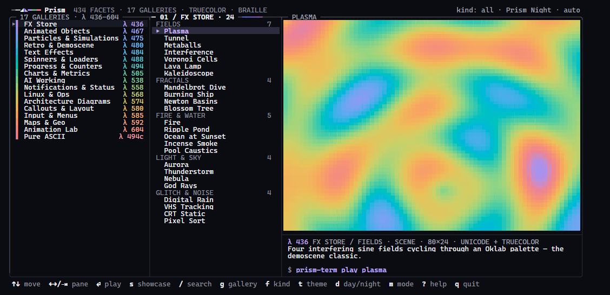
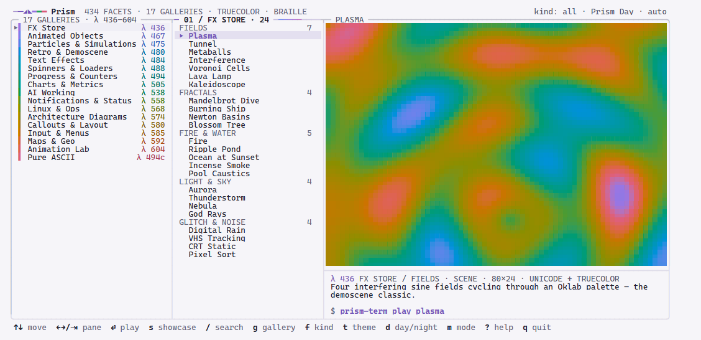
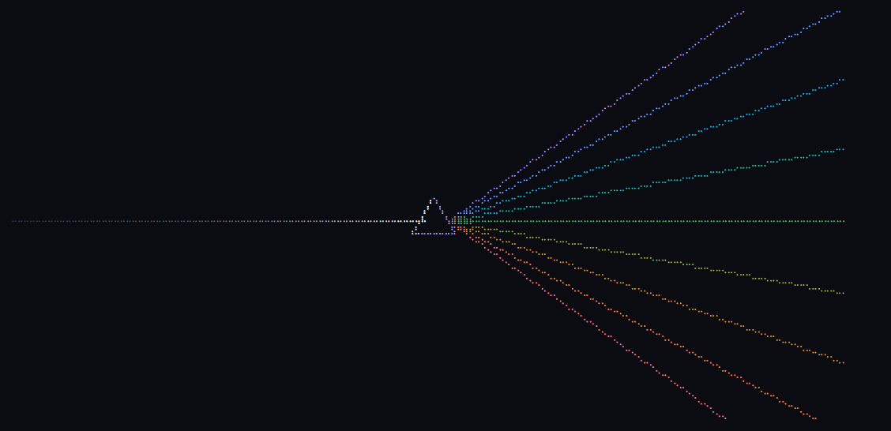
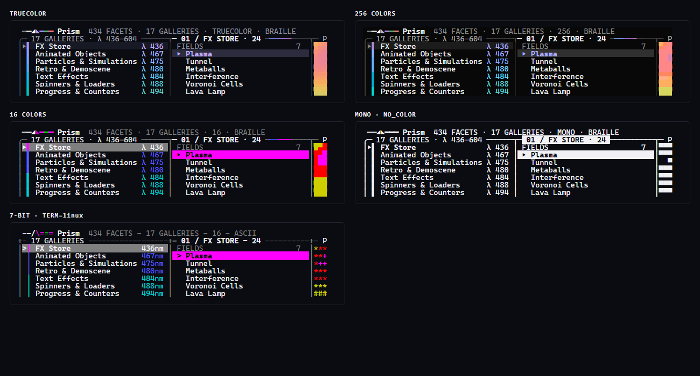
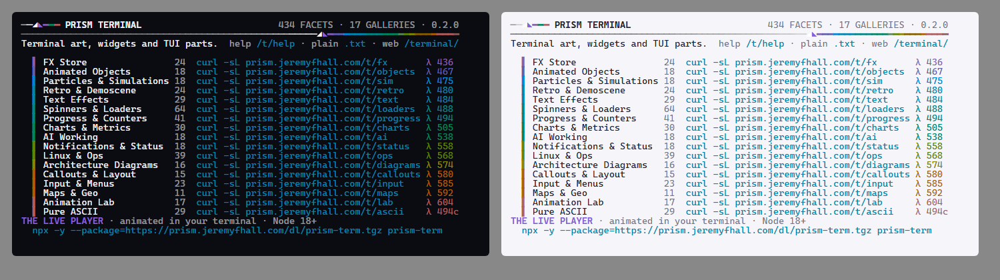

# Refraction in the terminal

*White light in, every color out* — Prism's design language, in cells. This is the grammar the
catalog browser (`prism-term`), the live player (`prism-term play`) and the curl site
(`curl -sL prism.jeremyfhall.com/tty`) are drawn in. The parts live in `src/refraction.js`; colors
are data (`TOKENS`, synced from `design/tokens.json` — `test/chrome.test.js` fails if they drift).

## 1 · The parts

| Part | Cells | Notes |
|---|---|---|
| **The beam** | `────────━━━──` | A hairline (`─`) lit where the light enters and fading along its length (`exp` falloff from the line color to the beam color). It may end in a **glint**: 5 cells of spectrum around a hue. Never a heavy rule. |
| **The mark** | `──◢◣━━━` | Beam in, the prism (◢ lit face in white, ◣ in the accent), spectrum out (violet → rose). 7-bit: `--/\===`. |
| **Spectral index** | `▌ FX Store  λ 436` | Every gallery owns a hue: even steps along the spectrum in nav order (`fx` λ 436 … `ascii` λ 494c). Swatch `▌` in the **vivid** tier, λ label and a lit title in the **ink** tier (≥ 4.5:1). `494c` = a purple's complementary wavelength. |
| **Instrument labels** | `01 / FX STORE · 24` | Upper-case, ` · ` separators, two-digit coordinates, counts. Filters and commands stay lower-case (`kind: all`, `$ prism-term play plasma`). |
| **Glass** | `╭─┬─╮ │ ├─┤ ╰─┴─╯` | One hairline frame per screen with shared dividers — never boxes side by side. The **top and left edges are lit** (line mixed 20% toward ink), bottom/right are plain line. |
| **Focus** | the beam | The focused pane's top edge *is* the beam, lit from its left corner, with a glint in its gallery's hue just past the title; its title goes bold ink. |
| **Selection** | `▸ Plasma` on glass | `panel2` washed 12% with the gallery hue, the title lit in the hue (bold), `▸` in the hue. Unfocused: plain `panel2`, ink, a dim `▸`. |
| **Key hints** | **`/`** search  **`?`** help | Key in bold ink, label in dim, two spaces between pairs, no background strip. They drop from the right as width runs out. |

## 2 · Day and Night

Prism Night is ink-navy glass with white light; Prism Day is pearl with the brand violet as its
light (the white beam would vanish there). Nothing is inverted: each mode takes its own tier of
the spectrum. The browser and player follow whatever theme was resolved — `--theme`, `--day` /
`--night`, `PRISM_TERM_THEME`, else `src/theme-detect.js` (COLORFGBG, then an OSC 11 query on
interactive TTYs only). **d** flips Day ↔ Night (also inside other families: `primer-dark` ↔
`primer-light`); **t** cycles every theme. Either relights the screen behind a vertical beam with a
spectral fringe (0.42 s, any key ends it).

## 3 · Motion

- **First Light** (browser launch, ≤ 1.5 s): dark glass → a hairline of white light crosses to a
  braille prism at the center → it fans into the spectrum → the spectrum paints the app in, left to
  right. Any key skips it and is *not* acted on. Full once per terminal session (a marker in the OS
  temp dir, keyed by `WT_SESSION` / `TERM_SESSION_ID` / tmux pane / parent PID), a 0.32 s echo after.
- **Prism wipe** (player, facet → facet): a white leading edge dispersing into the spectrum.
- **Never** for pipes, files, CI, `NO_COLOR`, mono, 7-bit, `--no-intro`, `PRISM_TERM_INTRO=0`,
  `--reduced-motion` or `PRISM_REDUCED_MOTION=1` (reduced motion also cuts wipes and sweeps).
- Chrome itself is still: only the preview, the intro and transitions move, so the diff renderer
  sends a few cells per frame (Windows timer note: `src/loop.js`).

## 4 · Density

One row of header, one row of key hints, one shared frame. Rows are single-spaced; category
headers are dim upper-case with their count right-aligned. The spectral index shows titles whole
from 140 columns (λ only), adds counts at 170; below 125 titles truncate. Below 110 columns the
galleries pane becomes the `◀ FX Store · 24 ▶` switcher; below 64 the preview goes.

## 5 · Degradation

| Depth | What changes |
|---|---|
| **truecolor** | As designed. |
| **256** | Colors land on xterm-256 by Oklab distance (tokens on their designed index). Gradients step. |
| **16** | Hairlines lift to bright black so they don't vanish into the background; the hue-washed lift can't exist, so the focused selection is a **solid hue bar** with dark text, the unfocused one a gray bar. Theme tokens use their designed ANSI slots. |
| **mono** (`NO_COLOR`) | Focused selection and the focused pane title are **inverse video**; unfocused selection is bold. The mark keeps its shape, the prism in bold. No intro. |
| **7-bit** (`asciiSurface`, TERM=linux, LANG=C) | `+-|` frames, `>` marker, `\|` swatches, `--/\===` mark, `436nm` labels, `jk` / `<>` / `Enter` key names. Catalog text goes through `asciify`, facets through `asciiSurface`. No intro. |

## 6 · The curl site

Pages are 80 columns of SGR + text. The reader's background is unknown, so chrome text uses
**balanced tones**: relative luminance ≈ 0.18, which is ≥ 4.5:1 on both a black and a white
terminal (`siteTone`). Each page: the mark + `PRISM TERMINAL › CRUMBS` + a right-aligned instrument
label, then the full-width beam striking the prism at column 54 and leaving as spectrum (a gallery
or facet page leaves only its own band). Section labels are `01 / NAME · COUNT ────` in the
gallery's tone. Home is the spectral index: swatch, title, count, the command, its λ label.
Facet stills are rendered in Prism Night — dark tiles on any terminal. `.txt` is 7-bit with the
same structure (`--/\===`, `|` swatches, `436nm`).

## 7 · Rules of thumb

1. Light is the material: emphasis = brighter at Night, deeper by Day (`lift`); never hard-code
   `0xffffff` — use the theme's light (white at Night, ink by Day).
2. Text on a fill picks its own ink (`onFill`): dark on light fills, white on dark ones.
3. Depth from light, not shadows: drop shadows are soft scrims (≤ 40% at Night, ≤ 7% by Day).
4. One hue per gallery, one beam per screen, one glint per focused pane. Restraint.
5. Every part has a 7-bit and a mono form, or it doesn't ship.
